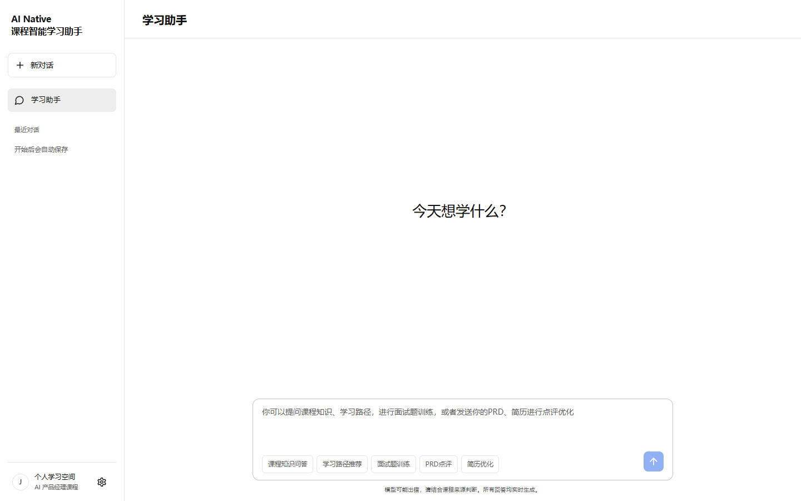
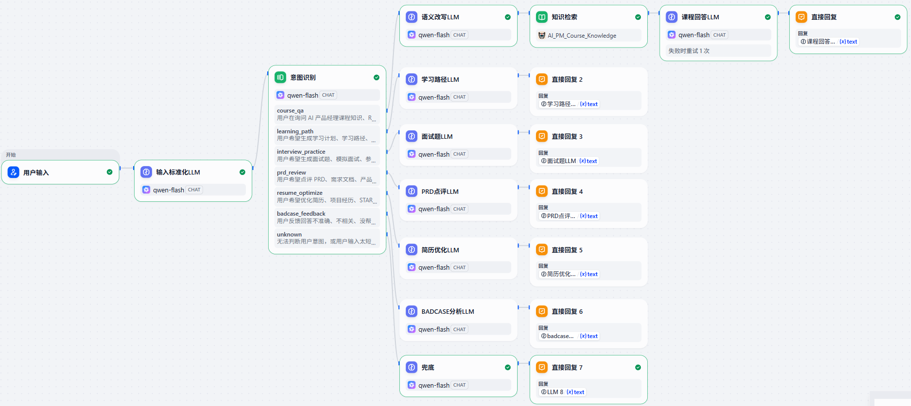
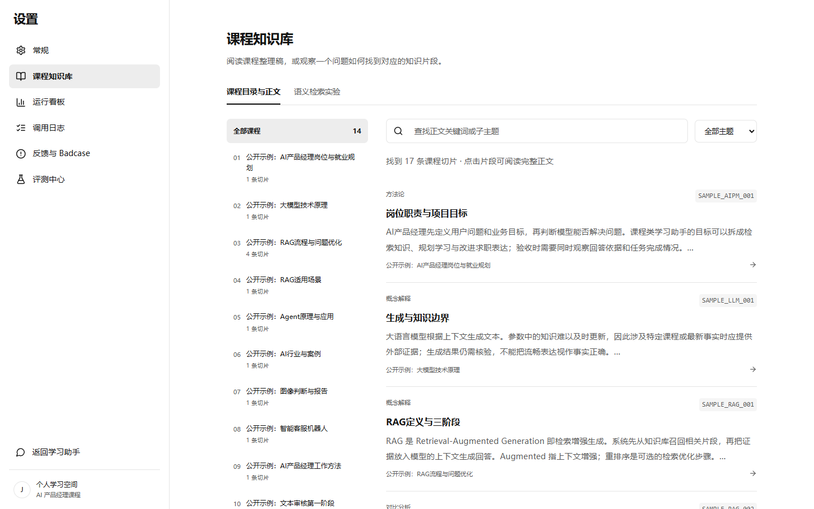
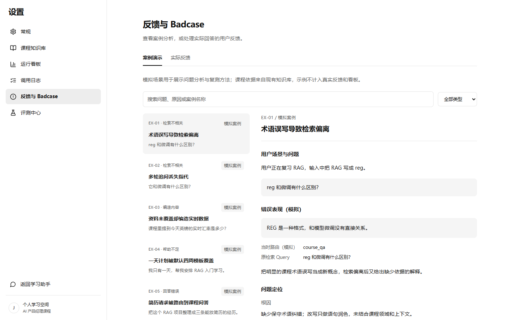

# AI Native 课程智能学习助手

基于 RAG + Agent 的 AI 产品经理课程学习应用。支持课程知识问答、学习路径推荐、面试题训练、PRD 点评和简历优化，可在本地启动为网页使用。



## 功能

- **课程知识问答**：结合会话上下文改写问题，检索课程片段，生成可查看来源的回答。
- **学习路径推荐**：根据学习基础、目标和可用时间生成计划，并支持后续调整。
- **面试题训练**：围绕课程主题出题，逐题接收回答并提供点评、参考要点和追问。
- **PRD 点评**：分析粘贴的需求文档，给出问题定位、修改建议和验收要点。
- **简历优化**：梳理项目表述，给出修改建议并提示需要补充的事实或数据。
- **运行分析**：查看检索来源、路由过程、调用日志、反馈、Badcase 和评测结果。

聊天输入框提供五个功能标签。选择标签后进入对应 Skill；不选择时，由 Router 识别意图并自动路由。

## Dify 工作流

在 Dify 中编排了从用户输入、输入标准化和意图识别，到课程问答、学习路径、面试训练、PRD 点评、简历优化及 Badcase 分析等分支的工作流。课程问答分支包含语义改写、知识检索和课程回答。



## 页面预览

| 课程知识库 | 反馈与 Badcase |
| --- | --- |
|  |  |

## 技术架构

| 模块 | 技术 |
| --- | --- |
| 前端 | React、TypeScript、Vite |
| 后端 | FastAPI、Python |
| 语言模型 | 阿里云百炼 `qwen3.8-flash`（可配置） |
| 向量检索 | `BAAI/bge-small-zh-v1.5`、Chroma |
| 数据存储 | SQLite |

请求链路：用户输入与会话上下文 → 意图识别或指定 Skill → 必要时改写 Query 并检索课程 → 模型生成 → 来源校验与执行记录 → 反馈和评测。

## 快速开始

运行环境：Windows、Python 3.12、Node.js/npm，首次安装需要网络连接。

1. 双击 `setup.cmd`，安装依赖、下载 Embedding 模型、建立向量库并构建前端。
2. 复制 `.env.example` 为 `.env`，填写 `DASHSCOPE_API_KEY`。
3. 双击 `start.cmd`，打开 [http://localhost:8000](http://localhost:8000)。
4. 使用结束后双击 `stop.cmd`。

默认使用 [`examples/course_chunks_sample.csv`](examples/course_chunks_sample.csv) 中的 17 条课程主题样例。若要使用自己的课程数据，可在首次运行 `setup.cmd` 前将同字段 CSV 放入 `data/course_chunks.csv`，程序会据此建立本地向量索引。`.env`、`data/`、模型文件和运行日志不会进入仓库。

## 项目结构

```text
backend/           API、Router、Skill、检索、日志与评测
frontend/          React 应用与浏览器测试
examples/          默认课程样例数据
evals/             检索测试数据与结果汇总
docs/              产品和技术文档、页面截图
legacy/streamlit/  早期 Streamlit 代码
tests/             后端测试
setup.cmd          初始化环境和知识库
start.cmd          启动本地服务
stop.cmd           停止本地服务
```

## 测试

```powershell
.\.venv\Scripts\python.exe -m pytest -q
cd frontend
npm run build
npm run test
```

浏览器测试需要先启动服务；在线模型测试默认跳过，配置 API Key 并设置 `RUN_LIVE_TESTS=1` 后可运行。如果服务不在默认的 8000 端口，可设置 `TEST_BASE_URL` 指向实际地址。
