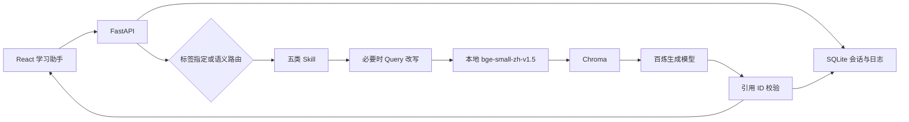

# 当前系统架构

`backend/agent.py` 负责一次请求的路由、上下文截取、改写、检索、流式生成、引用校验和执行追踪。`backend/knowledge.py` 加载 CSV、Embedding 模型与 Chroma 索引。`backend/storage.py` 用 SQLite 保存会话、消息、执行记录、反馈与评测。

会话上下文按 session_id 隔离，取最近 12 条消息并设置长度预算。课程问答使用模型改写检索 Query；规划、PRD 和简历任务保留输入素材，避免把缺失业务事实误判为检索条件。每次执行保存数据版本、Prompt 版本、目标 Skill、模型调用、来源、耗时与错误。

前端展示“检索候选”和“实际引用”两个概念：候选来自 Top-K 检索；实际引用须在模型回答中出现且通过 ID 校验。SQLite 中的技术成功表示流程完成，不代表答案事实正确。

公开仓库默认使用重新撰写的示例片段。完整课程库可由持有资料的作者在本机导入，不改变应用代码。详细说明见[知识库文档](knowledge-base.md)。
